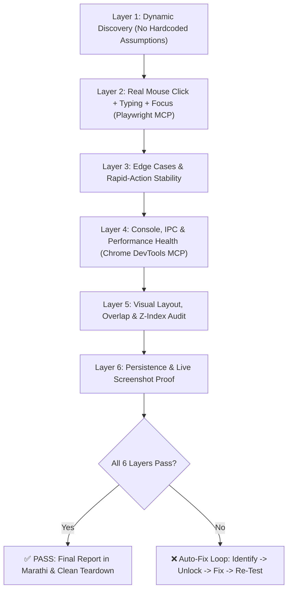

# 🧪 DocMitra Master QA & Testing Protocol (`TEST.md`)

> **MANDATORY POLICY FOR ALL AI AGENTS & CONTRIBUTORS**  
> **Trigger:** Whenever `@TEST.md` is tagged in any prompt (e.g., `@TEST.md Rename Tool Settings` or `@TEST.md PDF Studio`), the AI Agent **MUST AUTOMATICALLY EXECUTE** this **100% Free Dual-MCP Real Desktop App Testing Protocol** (Playwright MCP + Chrome DevTools MCP) with **ZERO paid tools** and **ZERO browser tab proxies**.

---

## 🛑 1. Core Rule: REAL DESKTOP APP ONLY (No Localhost Browser Tabs)

```
       ❌ NEVER DO THIS                           ✅ ALWAYS DO THIS
+------------------------------+           +---------------------------------------+
|  http://localhost:3000/app   |           | C:\Users\USER\AppData\Local\DocMitra  |
|  (Regular Chrome Browser Tab)|           | \app.exe (Actual Tauri Desktop App)   |
|  - Fake environment          |           | - Native Rust IPC Backend             |
|  - Missing native disk APIs  |           | - WebView2 Engine at port 9222        |
+------------------------------+           +---------------------------------------+
```

1. **Zero Browser Tab Testing:** Never spin up a mock browser tab on `http://localhost:3000` to simulate tests.
2. **Launch Real Installed Binary:** Always launch the actual release binary located at:
   ```
   C:\Users\USER\AppData\Local\DocMitra\app.exe
   ```
3. **Enable WebView2 Remote Debugging (Port 9222):**
   Launch the app with remote debugging enabled using PowerShell:
   ```powershell
   $env:WEBVIEW2_ADDITIONAL_BROWSER_ARGUMENTS = "--remote-debugging-port=9222"
   Start-Process -FilePath "C:\Users\USER\AppData\Local\DocMitra\app.exe" -ArgumentList "--remote-debugging-port=9222"
   Start-Sleep -Seconds 2
   ```
4. **Connect Dual-MCP via CDP:**
   - **Playwright MCP:** Connect directly to the live app via CDP:
     ```javascript
     const browser = await chromium.connectOverCDP('http://127.0.0.1:9222');
     const context = browser.contexts()[0];
     const page = context.pages()[0] || await context.newPage();
     ```
   - **Chrome DevTools MCP:** Connect directly to the debugging endpoint `http://127.0.0.1:9222` to inspect console logs, network events, and DOM state.

---

## 🔬 2. The 6-Layer Smart Automated Verification Framework

When `@TEST.md` is triggered for any module, screen, or modal, execute all 6 layers sequentially:



---

### 🔍 Layer 1 — Dynamic Discovery (Zero Hardcoded Assumptions)
- **Do NOT guess or assume** UI elements, IDs, or keyboard shortcuts.
- **Dynamically discover** the target screen's real DOM state:
  ```javascript
  // Discover actual visible interactive elements on the target screen
  const discovery = await page.evaluate((scopeSelector) => {
    const root = scopeSelector ? document.querySelector(scopeSelector) : document.body;
    const buttons = Array.from(root.querySelectorAll('button:not([disabled])'))
      .filter(b => b.offsetParent !== null)
      .map(b => ({ id: b.id, text: b.innerText.trim(), title: b.title }));
    const inputs = Array.from(root.querySelectorAll('input:not([type="hidden"]), select, textarea'))
      .filter(i => i.offsetParent !== null)
      .map(i => ({ id: i.id, type: i.type, value: i.value, placeholder: i.placeholder }));
    return { buttons, inputs };
  }, targetScope);
  ```
- **Shortcut Verification:** Query and test **ONLY** the keyboard shortcuts documented or implemented for that specific screen (e.g. `Enter` for confirm, `Esc` for dismiss, `F2` for folder, `Tab` for focus cycle). Do not test shortcuts that do not exist on that screen.

---

### 🖱️ Layer 2 — Real Mouse Click + Typing + Focus Verification (Playwright MCP)
1. **Mouse Clicks:**
   - Click every discovered interactive button, tab, modal trigger, and close button.
   - Verify hover states and active button feedback.
2. **Text Typing & Focus:**
   - Click into text input fields; verify `:focus` state and caret visibility.
   - Type normal alphanumeric text, mixed-case text (`Upper`, `lower`, `Title`).
   - Type special characters (`_`, `-`, `/`, `.`) and test `Backspace` / `Delete`.
   - Verify that previews, counters, formulas, and badges update in real time on keystroke.
3. **Keyboard Navigation:**
   - Test `Tab` key forward focus cycle and `Shift+Tab` backward cycle.
   - Test `Enter` key execution on primary actions.
   - Test `Escape` key dismissal on open modals.

---

### ⚡ Layer 3 — Edge Cases & Rapid-Action Stability
1. **Empty & Invalid Submissions:**
   - Submit empty inputs or spaces-only inputs $\rightarrow$ verify graceful warning/toast, never crash.
   - Input excessively long strings (100+ chars) $\rightarrow$ verify text wrapping or truncation without UI blowout.
2. **Rapid Action & Debounce Check:**
   - Fire rapid double/triple clicks on primary save/action buttons $\rightarrow$ verify operation executes exactly once (zero duplicate rows, zero duplicate disk calls).
3. **Cancel & Modal Lifecycle:**
   - Open modal $\rightarrow$ edit fields $\rightarrow$ click Cancel or press `Escape` $\rightarrow$ verify changes are cleanly discarded and modal closes instantly.

---

### 🛡️ Layer 4 — Console, IPC & Performance Health (Chrome DevTools MCP)
1. **Zero Console Errors:**
   - Query all console messages via Chrome DevTools MCP.
   - **Strict Requirement:** Exactly **0 console errors** and **0 uncaught runtime exceptions**.
2. **Rust / Tauri IPC Integrity:**
   - Verify all native IPC calls (`read_binary_file`, `rename_native_file`, `scan_directory`, etc.) succeed with valid payloads.
   - Zero broken IPC promises or unhandled rejections.
3. **Responsiveness:**
   - Confirm UI main thread never freezes or stutters during file loading, matching, or saving.

---

### 📐 Layer 5 — Visual Layout, Overlap & Z-Index Audit
1. **Bounding Box Overlap Check:**
   - Compute bounding rectangles (`getBoundingClientRect()`) of adjacent buttons and inputs.
   - Guarantee **0 pixel overlap** between neighboring elements.
2. **Text Clipping & Truncation Check:**
   - Ensure labels, table headers, and badges have adequate padding.
   - Where long text is truncated (`text-ellipsis`), verify `title` attribute shows full text on hover.
3. **Z-Index & Stacking Context Isolation:**
   - When a child modal (e.g., `#modalAddDocument`) opens over a parent modal (e.g., `#modalRenameSettings`):
     - Parent modal: `z-index: 1000`
     - Child modal & backdrop: `z-index: 9999`
   - Child modal MUST always render visually and functionally **strictly ON TOP** of parent modals and backdrops.

---

### 💾 Layer 6 — Persistence & Live Screenshot Proof
1. **Persistence Verification:**
   - Save a change (new preset doc, customized shortcut, style toggle).
   - Reload workspace or reopen modal $\rightarrow$ verify newly added data is intact in memory and storage.
2. **Live Desktop Screenshot:**
   - Capture a full-window screenshot of the active desktop app state:
     ```javascript
     await page.screenshot({ path: 'C:/Users/USER/AppData/Local/DocMitra/window_shot.png' });
     ```
   - Provide the screenshot path in the final report as tangible visual verification proof.

---

## 🔄 3. Auto-Fix Loop & Teardown

```
                      +-------------------+
                      |   Run @TEST.md    |
                      +---------+---------+
                                |
                        [Layer Failure?]
                         /             \
                       YES              NO
                       /                 \
         +------------v-----------+   +---v-----------------------+
         | 1. Report root cause   |   | All 6 Layers PASS         |
         |    in clear Marathi    |   | 1. Cleanly close app.exe  |
         | 2. Request unlock      |   | 2. Re-lock target tool    |
         | 3. Fix code            |   | 3. Final Marathi Report   |
         | 4. Re-run @TEST.md     |   +---------------------------+
         +------------------------+
```

1. **Auto-Fix Protocol:**
   - If ANY of the 6 layers fail, the agent must NOT ignore it or declare the task done.
   - State the exact failing layer, selector, and root cause in Marathi.
   - Unlock the tool per `AGENTS.md` rules, fix the bug cleanly, and re-run `@TEST.md`.
2. **Clean Process Teardown:**
   - After testing is complete, always cleanly terminate the background debug app instance:
     ```powershell
     Stop-Process -Name "app" -Force -ErrorAction SilentlyContinue
     ```

---

## 📋 4. Dual-MCP Verification Output Template (मराठी अहवाल)

Whenever `@TEST.md` completes, output the final report using this exact structure:

```markdown
### 🧪 Dual-MCP Real Desktop App QA अहवाल (`@TEST.md`)

- **लक्ष्य स्क्रीन / मॉड्युल:** <Module / Screen Name>
- **ॲप बायनरी:** `C:\Users\USER\AppData\Local\DocMitra\app.exe` (Port 9222 CDP)
- **तपासणी साधने:** Playwright MCP + Chrome DevTools MCP (100% मोफत, 0 सशुल्क टूल्स)

| लेअर क्र. | तपासणी स्तर (Verification Layer) | स्थिती | निरीक्षण व पडताळणी तपशील |
| :---: | :--- | :---: | :--- |
| **१** | **Dynamic Discovery** | ✅ PASS | प्रत्यक्ष स्क्रीनवरील X बटणे, Y इनपुट्स आणि शॉर्टकट्स शोधले. |
| **२** | **Clicks, Typing & Focus** | ✅ PASS | सर्व बटणे, इनपुट फोकस, टायपिंग आणि रिअल-टाईम प्रिव्ह्यू यशस्वी. |
| **३** | **Edge Cases & Stability** | ✅ PASS | रिकामे इनपुट्स, रॅपिड क्लिक्स आणि Esc/Cancel वर ० क्रॅश. |
| **४** | **Console & IPC Health** | ✅ PASS | **० कन्सोल एरर्स (0 Errors)**, ० अनकॉट अपवाद, १००% सुरक्षित IPC. |
| **५** | **Visual Layout & Z-Index** | ✅ PASS | ० ओव्हरलॅपिंग घटक, चाइल्ड मोडल (z-9999) पॅरेंट मोडलच्या वर दिसले. |
| **६** | **Persistence & Screenshot** | ✅ PASS | डेटा सेव्ह खात्रीशीर, स्क्रीनशॉट जतन केला. |

📸 **पडताळणी स्क्रीनशॉट:** `C:\Users\USER\AppData\Local\DocMitra\window_shot.png`  
🎯 **अंतिम निष्कर्ष:** सर्व ६ स्तर १००% उत्तीर्ण (Production Ready)!
```
